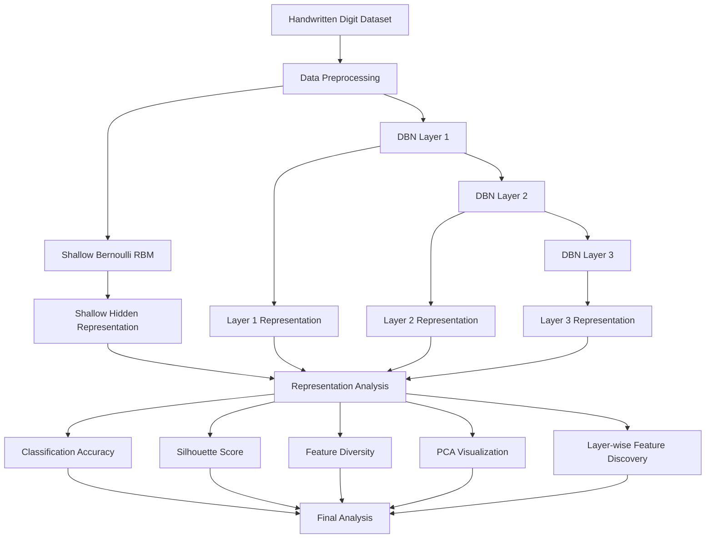
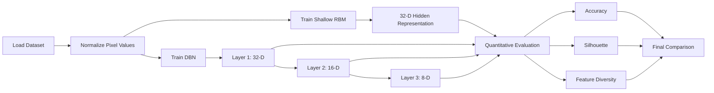

# Deep Belief Network-Based Feature Discovery

> **Comparative Analysis of a Shallow Probabilistic Model and a Deep Belief Network**

---

## 📌 Overview

This project investigates how increasing the depth of a probabilistic neural architecture affects **feature discovery and hidden representations**.

A **shallow Bernoulli Restricted Boltzmann Machine (RBM)** is first trained to learn a compact representation of handwritten digit images. A **Deep Belief Network (DBN)** is then constructed by stacking multiple Bernoulli RBMs and training them sequentially.

The learned representations are extracted from different depths and compared using:

- Classification accuracy
- Silhouette score
- Feature variation
- Number of informative features
- 2D PCA visualization
- Layer-wise feature activation analysis

The main objective is to understand whether additional hidden layers produce richer representations or excessive compression.

---

## 🎯 Problem Statement

> **Develop a Deep Belief Network and compare its hidden representations with those of a shallow probabilistic model. Analyze how additional hidden layers influence feature discovery.**

---

## 🎯 Objectives

- Develop a shallow probabilistic model using a Bernoulli RBM.
- Develop a Deep Belief Network using stacked Bernoulli RBMs.
- Extract hidden representations from different depths.
- Compare shallow and deep representations quantitatively.
- Visualize the feature representations.
- Analyze how additional hidden layers influence feature discovery.
- Identify changes in feature diversity and class separability.

---

## 🧠 Core Concept

A **Restricted Boltzmann Machine (RBM)** is a probabilistic model containing:

- A visible layer
- A hidden layer
- Weighted connections between visible and hidden units
- No connections between units within the same layer

A **Deep Belief Network (DBN)** can be created by stacking multiple RBMs so that the representation learned by one layer becomes the input to the next layer.

### Shallow Probabilistic Model

```text
Input Image
    │
    ▼
┌───────────────┐
│ Bernoulli RBM │
└───────────────┘
    │
    ▼
32-Dimensional
Hidden Representation
```

### Deep Belief Network

```text
Input Image
    │
    ▼
┌─────────────────┐
│ RBM - Layer 1   │
│ 64 → 32         │
└─────────────────┘
    │
    ▼
32-Dimensional
Representation
    │
    ▼
┌─────────────────┐
│ RBM - Layer 2   │
│ 32 → 16         │
└─────────────────┘
    │
    ▼
16-Dimensional
Representation
    │
    ▼
┌─────────────────┐
│ RBM - Layer 3   │
│ 16 → 8          │
└─────────────────┘
    │
    ▼
8-Dimensional
Representation
```

---

## 🔬 Project Architecture



---

## 🧩 Experimental Workflow



---

## 📊 Dataset

The project uses the **handwritten digits dataset provided by scikit-learn**.

| Property | Value |
|---|---:|
| Number of samples | 1,797 |
| Image size | 8 × 8 |
| Input features | 64 |
| Number of classes | 10 |
| Classes | 0–9 |
| Pixel normalization | 0–1 |

Each image is converted into a 64-dimensional feature vector before being passed to the probabilistic models.

---

## 🏗️ Model Configuration

### Shallow RBM

| Parameter | Value |
|---|---:|
| Visible units | 64 |
| Hidden units | 32 |
| Learning rate | 0.05 |
| Batch size | 32 |
| Training iterations | 30 |

### Deep Belief Network

| Layer | Input | Hidden |
|---|---:|---:|
| RBM 1 | 64 | 32 |
| RBM 2 | 32 | 16 |
| RBM 3 | 16 | 8 |

The DBN is trained layer-by-layer, with each RBM learning from the representation produced by the previous layer.

---

## 📈 Experimental Results

The final experiment produced the following results:

| Representation | Features | Test Accuracy | Silhouette Score | Mean Feature Std | Informative Features |
|---|---:|---:|---:|---:|---:|
| Shallow RBM | 32 | **85.83%** | **0.2096** | **0.2081** | **32/32** |
| DBN Layer 1 | 32 | **85.83%** | **0.2096** | **0.2081** | **32/32** |
| DBN Layer 2 | 16 | **71.11%** | **0.0915** | **0.1530** | **16/16** |
| DBN Layer 3 | 8 | **56.11%** | **-0.0195** | **0.0073** | **0/8** |

---

## 🔎 Key Findings

### 1. Shallow Representation

The shallow RBM produced a **32-dimensional representation** with:

- 85.83% classification accuracy
- 0.2096 silhouette score
- 0.2081 mean feature standard deviation
- All 32 hidden features showing meaningful variation

This provides the baseline for comparison.

### 2. DBN Layer 1

The first DBN layer uses the same 64 → 32 configuration as the shallow RBM.

Therefore, its representation is equivalent to the shallow baseline under the current experimental setup:

- 85.83% accuracy
- 0.2096 silhouette score
- 32 informative features

This provides a controlled baseline before additional layers are introduced.

### 3. DBN Layer 2

The second layer compresses:

```text
32 → 16 features
```

The representation becomes more compact, but its class separability and classification performance decrease:

- Accuracy: **71.11%**
- Silhouette score: **0.0915**
- Mean feature standard deviation: **0.1530**

### 4. DBN Layer 3

The third layer compresses:

```text
16 → 8 features
```

At this depth, the learned representation shows very low variation:

- Accuracy: **56.11%**
- Silhouette score: **-0.0195**
- Mean feature standard deviation: **0.0073**
- Informative features: **0/8**

This indicates that, under the current architecture and training configuration, the deepest representation becomes highly compressed and loses much of its discriminative variation.

---

## 🧠 Feature Discovery Analysis

The experiment demonstrates that **increasing depth does not automatically guarantee better feature discovery**.

In this particular configuration:

```text
Shallow RBM
    ↓
Strong feature variation
    ↓
DBN Layer 2
    ↓
Reduced variation
    ↓
DBN Layer 3
    ↓
Very low variation / representation collapse
```

The additional hidden layers progressively reduce the dimensionality of the representation. However, the deeper representation also becomes less separable with respect to the digit classes.

Therefore, the experiment suggests that **model depth, dimensionality, and training configuration must be balanced carefully**.

> **Important:** These observations are specific to the dataset, architecture, hyperparameters, and training configuration used in this project. They should not be interpreted as a general statement that deeper DBNs always perform worse.

---

## 📊 Visual Results

The project produces the following visual outputs:

### Shallow RBM Features

`results/shallow_rbm_features.png`

Displays the learned feature patterns of the shallow RBM.

### Shallow RBM PCA

`results/shallow_rbm_pca.png`

Displays the 32-dimensional shallow representation reduced to two dimensions using PCA.

### Representation Comparison

`results/representation_comparison.png`

Compares:

- Shallow RBM
- DBN Layer 1
- DBN Layer 2
- DBN Layer 3

using 2D PCA projections.

### Accuracy Comparison

`results/accuracy_comparison.png`

Compares classification performance across representations.

### Silhouette Comparison

`results/silhouette_comparison.png`

Compares class separability across representation depths.

### Layer-wise Feature Discovery

`results/layerwise_feature_discovery.png`

Shows average hidden-unit activation for each digit class across DBN layers.

### Final Comparison Figure

`results/final_comparison_figure.png`

Combines the major experimental observations:

- Classification accuracy
- Class separability
- Feature diversity

---

## 📁 Project Structure

```text
DBN_Feature_Discovery/
│
├── dataset/
│
├── notebooks/
│   └── DBN_Feature_Discovery.ipynb
│
├── results/
│   ├── shallow_rbm_features.png
│   ├── shallow_rbm_pca.png
│   ├── shallow_rbm_representation.npz
│   ├── dbn_representations.npz
│   ├── representation_comparison.png
│   ├── representation_metrics.csv
│   ├── accuracy_comparison.png
│   ├── silhouette_comparison.png
│   ├── layerwise_feature_discovery.png
│   ├── feature_diversity_metrics.csv
│   ├── final_experimental_results.csv
│   └── final_comparison_figure.png
│
├── screenshots/
│
├── src/
│   ├── 01_load_dataset.py
│   ├── 02_train_shallow_rbm.py
│   ├── 03_visualize_shallow_rbm.py
│   ├── 04_train_dbn.py
│   ├── 05_compare_representations.py
│   ├── 06_evaluate_representations.py
│   ├── 07_plot_metrics.py
│   ├── 08_feature_discovery.py
│   ├── 09_feature_diversity.py
│   ├── 10_final_results.py
│   └── 11_final_comparison_plot.py
│
├── .gitignore
├── README.md
└── requirements.txt
```

---

## ⚙️ Installation

### 1. Clone the repository

```bash
git clone <YOUR_GITHUB_REPOSITORY_URL>
cd DBN_Feature_Discovery
```

### 2. Create a virtual environment

```bash
python -m venv .venv
```

### 3. Activate the environment

#### Windows PowerShell

```powershell
.\.venv\Scripts\Activate.ps1
```

### 4. Install dependencies

```bash
pip install -r requirements.txt
```

---

## ▶️ Running the Project

Run the scripts in the following order:

```bash
python src/01_load_dataset.py
```

```bash
python src/02_train_shallow_rbm.py
```

```bash
python src/03_visualize_shallow_rbm.py
```

```bash
python src/04_train_dbn.py
```

```bash
python src/05_compare_representations.py
```

```bash
python src/06_evaluate_representations.py
```

```bash
python src/07_plot_metrics.py
```

```bash
python src/08_feature_discovery.py
```

```bash
python src/09_feature_diversity.py
```

```bash
python src/10_final_results.py
```

```bash
python src/11_final_comparison_plot.py
```

All generated analysis files are stored in:

```text
results/
```

### 📓 Running the Interactive Jupyter Notebook

An interactive, self-contained Jupyter Notebook covering the full end-to-end workflow, visualizations, and comparative analysis is available in the `notebooks/` directory:

```bash
jupyter notebook notebooks/DBN_Feature_Discovery.ipynb
```
or
```bash
jupyter lab notebooks/DBN_Feature_Discovery.ipynb
```

---

## 🛠️ Technologies Used

- **Python**
- **Jupyter Notebook**
- **NumPy**
- **Pandas**
- **Scikit-learn**
- **Matplotlib**
- **Bernoulli Restricted Boltzmann Machines**
- **Deep Belief Network architecture**
- **PCA**
- **Logistic Regression**
- **Silhouette Analysis**

---

## 🔬 Evaluation Strategy

The project evaluates learned representations from multiple perspectives.

### Classification Accuracy

Measures how useful the learned representation is for distinguishing the digit classes.

### Silhouette Score

Measures the degree of separation between class groups in the learned feature space.

### Feature Diversity

Measures variation in hidden-unit activations across samples.

### PCA Visualization

Provides a 2D view of the high-dimensional hidden representations.

### Layer-wise Activation Analysis

Examines how different hidden units respond to different digit classes.

---

## 🧪 Experimental Question

The project investigates the following research question:

> **How does increasing the number of hidden layers in a Deep Belief Network influence the diversity, compactness, and discriminative quality of learned feature representations compared with a shallow probabilistic model?**

---

## ✅ Conclusion

The experiment demonstrates that increasing hidden-layer depth changes the learned representation substantially.

For the configuration used in this study, deeper layers progressively reduce the dimensionality of the representation, while classification accuracy, class separability, and feature variation decrease.

The deepest layer shows extremely low feature variation, indicating that excessive compression under the current training configuration can lead to representation collapse.

The experiment therefore highlights the importance of selecting suitable network depth and training parameters when learning hierarchical representations.

---

## 📚 References

1. Scikit-learn documentation — `BernoulliRBM`
2. Scikit-learn documentation — `load_digits`
3. Scikit-learn documentation — PCA
4. Scikit-learn documentation — Logistic Regression
5. Scikit-learn documentation — Silhouette Score

---

## 👨‍💻 Author

**Meganath M**

**Course:** Deep Learning Essentials  
**Assignment:** Innovative Assignment – II  
**Project:** Deep Belief Network-Based Feature Discovery

---

## 📌 Academic Note

This project was developed as an individual academic implementation. The source code, experiments, visualizations, and analysis are organized to support reproducibility and demonstration during evaluation.
